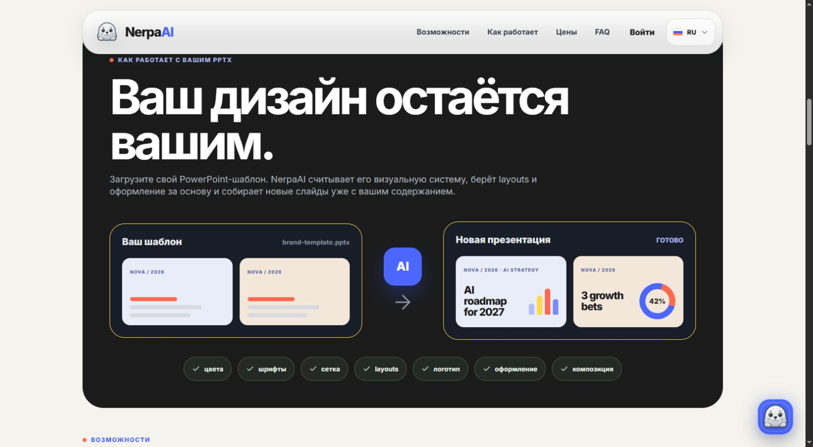
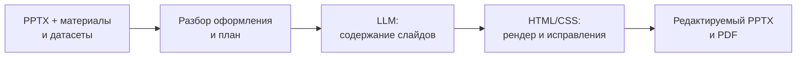
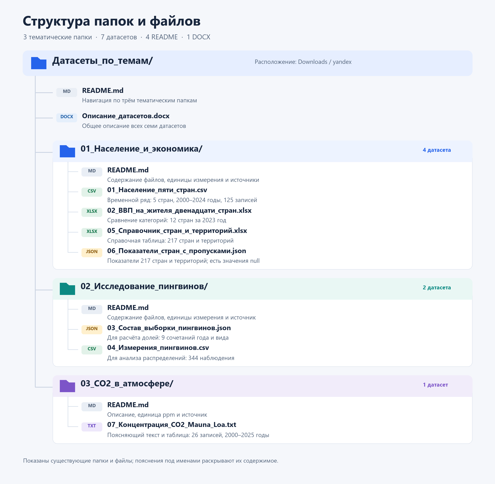
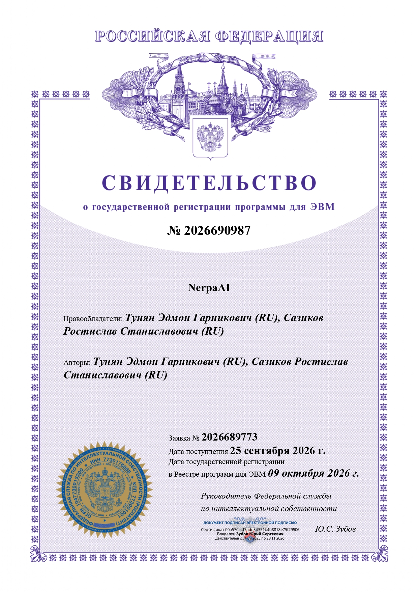

  

  <strong>AI-движок презентаций на основе вашего PowerPoint-шаблона и ваших данных.</strong> 
  Языковые модели · анализ PPTX · измеряемая вёрстка · редактируемый результат

  <a href="https://nerpa.ai/"><strong>Открыть NerpaAI ↗</strong></a>
  &nbsp; · &nbsp;
  <a href="#about">О проекте</a>
  &nbsp; · &nbsp;
  <a href="#technology">Технологии</a>
  &nbsp; · &nbsp;
  <a href="#datasets">Датасеты</a>
  &nbsp; · &nbsp;
  <a href="#registration">Регистрация РИД</a>

---

## Презентация начинается со смысла

**NerpaAIFree** — экспериментальная версия движка кастомных презентаций проекта **NerpaAI**. Его задача — превратить тему, исходные материалы и структурированные данные в последовательный рассказ, сохранив визуальную основу пользовательского PPTX.

Движок разбирает оформление шаблона, помогает построить план, связывает слайды с данными и подготавливает содержание. Затем измеряет фактическую вёрстку и формирует **PPTX и PDF**. Поддерживаемые тексты, таблицы и диаграммы сохраняются как редактируемые объекты PowerPoint.

  
   Главный экран публичного сервиса NerpaAI · снимок 20 октября 2026 года.

### Что лежит в основе

| | Возможности движка |
| :--- | :--- |
| **Ваш визуальный стиль** | Разбор структуры PPTX, исходных композиций, цветов, шрифтов и геометрии объектов. Пользовательский шаблон становится основой новых слайдов. |
| **Последовательное содержание** | Построение плана по теме и материалам, выбор макетов, генерация текста и согласование структуры слайдов. |
| **Работа с данными** | Импорт JSON, XML, CSV, TSV, Excel, ODS и текстовых таблиц. Сохранение значений, единиц измерения, периодов и пропусков при привязке к визуализациям. |
| **Измеряемая вёрстка** | Рендер HTML/CSS, анализ переполнений и пересечений, смысловая и визуальная оценка, ограниченные исправления проблемных участков. |
| **Рабочий результат** | Экспорт презентации и PDF, промежуточные JSON-документы, история этапов и замечания к результату. |

  
   Работа с пользовательским PPTX — одна из ключевых идей NerpaAI.

> Скриншоты показывают публичный сервис [nerpa.ai](https://nerpa.ai/). Этот репозиторий посвящён экспериментальному движку кастомных презентаций и сопровождающим датасетам.

## Технологии, которые работают вместе

Модель отвечает за содержание, а сервер — за структуру документов, точность привязанных данных и подготовку файлов. Между генерацией текста и итоговой презентацией есть отдельный этап реального рендера.

| Слой | Технологии и назначение |
| :--- | :--- |
| **Серверная логика** | **TypeScript · Node.js · Express · Zod** — API, управление этапами и проверка структурированных ответов. |
| **Смысловой слой** | **Qwen через OpenAI-совместимый API** — планирование, генерация содержания и запросы на оценку слайдов. |
| **PowerPoint и OOXML** | **Python · lxml · Pydantic** — разбор пакета презентации, моделей объектов и исходного оформления. |
| **Вёрстка и документы** | **Chromium · Playwright · LibreOffice · PyMuPDF** — браузерные измерения, подготовка PPTX/PDF и изображений слайдов. |
| **Структурированные данные** | **SheetJS · JSZip · XML-парсер · worker threads** — чтение таблиц и документов в ограниченных по ресурсам обработчиках. |
| **Изоляция и воспроизводимость** | **Docker · SHA-256 · JSON-контрольные точки** — обработка PPTX без сети, привязка к исходным файлам и сохранение состояния этапов. |

Фактические значения из датасетов связываются с диаграммами и таблицами на стороне сервера. Источники, пропуски и единицы измерения сохраняются в контексте данных. Исходные цифры из дизайнерского шаблона служат образцами оформления, а не фактами новой презентации.

## Данные, на которых можно показать идею

В репозиторий включены **7 датасетов по 3 предметным темам**. Они позволяют изучать временные ряды, сравнивать категории, работать с долями, распределениями и неполными данными.

| Тема | Файлов | Что внутри |
| :--- | :---: | :--- |
| [**Население и экономика**](Датасеты_по_темам/01_Население_и_экономика/README.md) | **4** | Население, ВВП на жителя, справочник стран и социально-экономические показатели с пропусками. |
| [**Исследование пингвинов**](Датасеты_по_темам/02_Исследование_пингвинов/README.md) | **2** | Состав выборки по видам и сезонам, морфологические измерения отдельных птиц. |
| [**CO₂ в атмосфере**](Датасеты_по_темам/03_CO2_в_атмосфере/README.md) | **1** | Среднегодовая концентрация CO₂ на Mauna Loa за 2000–2025 годы. |

  

<strong>Состав всех семи датасетов</strong>

| Датасет | Формат | Объём |
| :--- | :---: | :--- |
| [Население пяти стран](Датасеты_по_темам/01_Население_и_экономика/01_Население_пяти_стран.csv) | CSV | 125 записей · 2000–2024 |
| [ВВП на жителя двенадцати стран](Датасеты_по_темам/01_Население_и_экономика/02_ВВП_на_жителя_двенадцати_стран.xlsx) | XLSX | 12 стран · 2023 год |
| [Состав выборки пингвинов](Датасеты_по_темам/02_Исследование_пингвинов/03_Состав_выборки_пингвинов.json) | JSON | 9 сочетаний вида и сезона |
| [Измерения пингвинов](Датасеты_по_темам/02_Исследование_пингвинов/04_Измерения_пингвинов.csv) | CSV | 344 наблюдения |
| [Справочник стран и территорий](Датасеты_по_темам/01_Население_и_экономика/05_Справочник_стран_и_территорий.xlsx) | XLSX | 217 стран и территорий |
| [Показатели стран с пропусками](Датасеты_по_темам/01_Население_и_экономика/06_Показатели_стран_с_пропусками.json) | JSON | 217 стран и территорий · значения null |
| [Концентрация CO₂ Mauna Loa](Датасеты_по_темам/03_CO2_в_атмосфере/07_Концентрация_CO2_Mauna_Loa.txt) | TXT | 26 годовых записей · 2000–2025 |

**[Открыть каталог датасетов →](Датасеты_по_темам/README.md)** · [Описание всех наборов в DOCX](Датасеты_по_темам/Описание_датасетов.docx)

Источники — **World Bank WDI / Country API**, **Palmer Penguins** и **NOAA GML / Scripps**. Исходные ссылки, единицы измерения, условия использования и оговорки приведены в README соответствующих тем. Для пингвинов речь идёт об исследованной выборке, а не о численности популяции; пропуски в данных стран не заменяются нулями.

## Зарегистрированный результат интеллектуальной деятельности

**NerpaAI** — программа для ЭВМ, указанная в предоставленном свидетельстве о государственной регистрации.

| Сведения | По свидетельству |
| :--- | :--- |
| **Регистрационный номер** | **2026690987** |
| **Дата государственной регистрации** | **09 октября 2026 года** |
| **Номер заявки** | **2026689773** |
| **Дата поступления заявки** | **25 сентября 2026 года** |
| **Авторы и правообладатели** | **Тунян Эдмон Гарникович; Сазиков Ростислав Станиславович** |

  
   Нажмите на свидетельство, чтобы открыть изображение в полном размере.

---

  <strong>Ваш дизайн. Ваши данные. Ваша история.</strong> 
  <a href="https://nerpa.ai/">nerpa.ai ↗</a>

